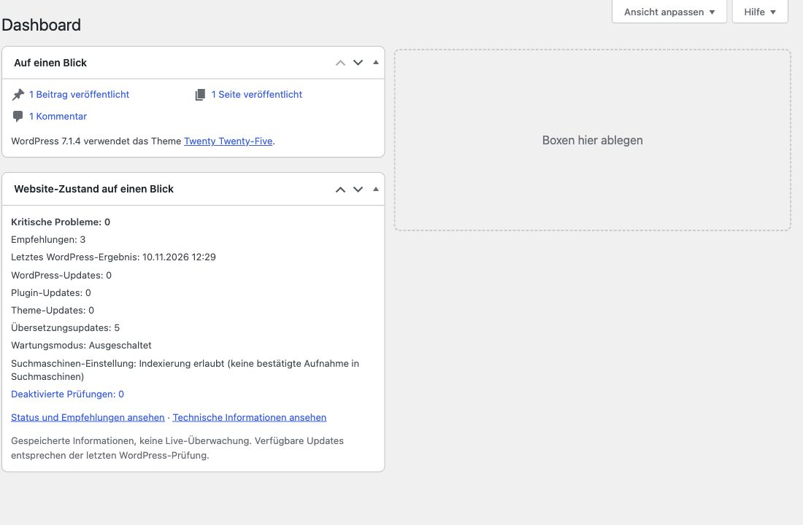
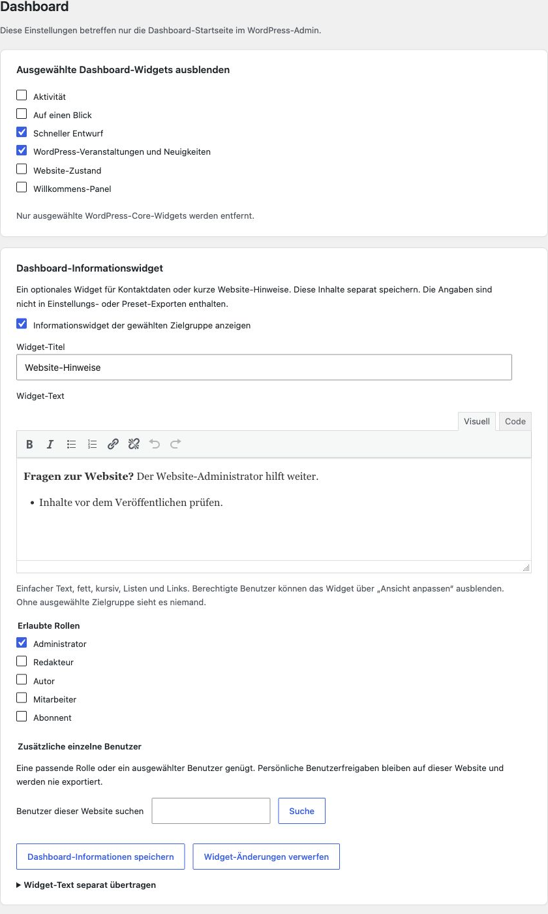
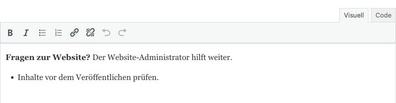

# Dashboard: Überblick und eigene Informationen

[English](Dashboard) · [Startseite](Home-de)

Diese Rubrik betrifft nur die Dashboard-Startseite im WordPress-Admin, nicht die Widgets für Theme-Seitenleisten.

## Website-Zustand auf einen Blick

Unter **Einstellungen → Site Essentials → Dashboard** das Site-Essentials-Widget zum Website-Zustand aktivieren und **Alle Einstellungen speichern**. Es ersetzt optional das native Zustandswidget. Die übrigen Website-Zustandsoptionen bleiben in ihrer eigenen Rubrik.

Danach **Werkzeuge → Website-Zustand** öffnen und warten, bis alle Prüfungen abgeschlossen sind. Erst dann stehen verlässliche gespeicherte Ergebniszahlen bereit. Das Widget zeigt kritische Probleme, Empfehlungen und den Zeitpunkt des letzten nativen Ergebnisses. Dazu kommen vorhandene Updatezahlen, Wartungszustand, Indexierungseinstellung und deaktivierte Prüfungen. Die beiden Links öffnen **Zustand** und **Bericht**.

**Keine Live-Überwachung:** Im Dashboard werden weder Prüfungen noch externe Updateabrufe gestartet. Fehlende oder veraltete Ergebnisse sowie nach einer Prüfauswahl ungültige Ergebnisse werden entsprechend benannt. Eine erlaubte Indexierung bedeutet nicht, dass Suchmaschinen die Website bereits aufgenommen haben.

Über **Konfigurieren** im Widget lassen sich persönliche Zusatzzeilen wählen. Über **Ansicht anpassen** kann jeder berechtigte Benutzer das Widget für sich ausblenden. [Herkunft, Prüfauswahl und Berichtsauslassungen](Website-Zustand) werden separat verwaltet.

## Weitere Dashboard-Hilfen

## 1. Das native Dashboard aufräumen

Nur die WordPress-Widgets auswählen, die ausgeblendet werden sollen, und **Alle Einstellungen speichern** verwenden. Widgets anderer Plugins und deren Einstellungen werden nicht gelöscht.

## 2. Ein hilfreiches Informationswidget anlegen

Das Informationswidget aktivieren, einen kurzen Titel eingeben und Kontaktdaten oder Hinweise zur Website ergänzen. Fett, kursiv, Listen und Links sind möglich; bei Bedarf zwischen Visuell und Code wechseln.

Die nativen Widget-Optionen und das Informationswidget stehen zusammen. Das Informationswidget hat einen eigenen Speichern-Button.

Listenzeichen bleiben innerhalb des Editors sichtbar. Das Beispiel enthält keine Kundendaten.

## 3. Zielgruppe auswählen und speichern

Jede erlaubte Rolle einzeln auswählen und bei Bedarf weitere Benutzer dieser Website suchen. Eine passende Rolle **oder** eine persönliche Freigabe genügt. Ohne Zielgruppe sieht niemand das Widget; Administratoren erhalten nicht automatisch Zugriff.

**Dashboard-Informationen speichern** verwenden und das Dashboard mit einem berechtigten Benutzer öffnen. Benutzer können das Widget persönlich über **Ansicht anpassen** ausblenden. Andere offene Entwürfe vor dem Speichern eines anderen Bereichs speichern oder verwerfen.

## Text bewusst übertragen

Normale Einstellungs- und Preset-Exporte enthalten weder Widget-Text noch persönliche Freigaben. Die separate Textübertragung erfordert eine ausdrückliche Bestätigung und überträgt nur den gespeicherten Titel und Text. Beim Import bleiben Aktivierung und Zielgruppe erhalten. Kontaktdaten vor der Verwendung auf einer anderen Website prüfen.

Abschalten und Deinstallation erhalten die Widget-Konfiguration. Das Zurücksetzen von Site Essentials entfernt sie. [Lokale Avatare und Entwickler-Filter](Verwaltungshilfen) sind separat dokumentiert.
