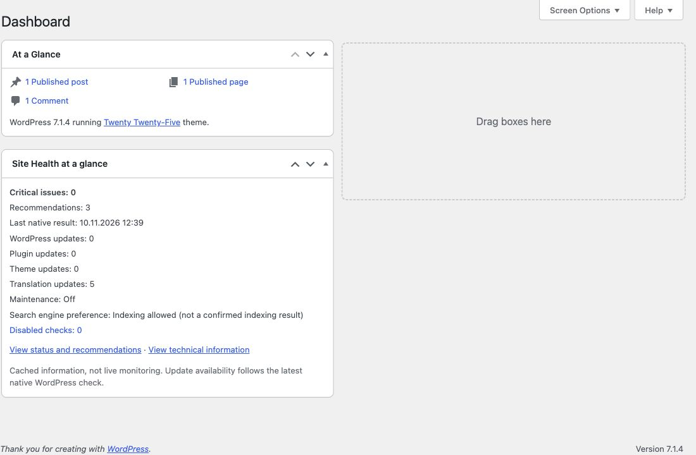
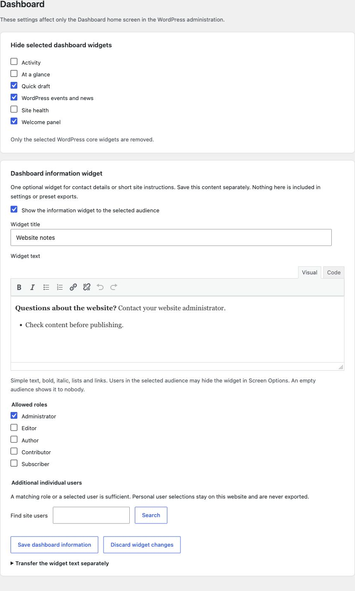
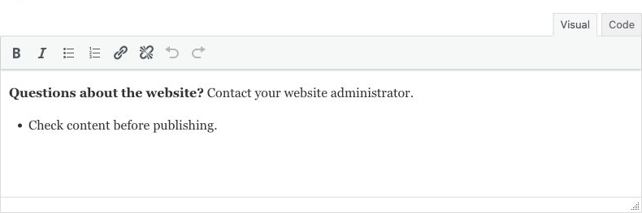

# Dashboard: overview and your own information

[Deutsch](Dashboard-de) · [Home](Home)

This section affects the WordPress admin Dashboard home page, not theme sidebar widgets.

## Site Health at a glance

Under **Settings → Site Essentials → Dashboard**, enable the Site Essentials Site Health widget and **Save all settings**. It optionally replaces the native health widget. Other Site Health options stay in their own section.

Then open **Tools → Site Health** and let all checks finish. Reliable saved result counts become available after completion. The widget shows critical issues, recommendations and the latest native result timestamp. Existing update counts, maintenance status, the indexing preference and disabled checks provide context. The two links open **Status** and **Info**.

**No live monitoring:** The Dashboard starts neither checks nor external update requests. Missing, stale or invalidated results after a check-selection change are identified accordingly. Allowing indexing does not confirm that search engines have indexed the website.

Use **Configure** in the widget to choose personal extra rows. Authorized users can hide the widget through **Screen Options**. Manage [sources, check selection and report omissions](Site-Health) separately.

## Other Dashboard helpers

## 1. Keep the native Dashboard clear

Select only the WordPress widgets you want to hide, then use **Save all settings**. Third-party widgets and their settings are not deleted.

## 2. Write one useful information widget

Enable the information widget, enter a short title and add contact information or website instructions. Use bold, italic, lists and links; switch between Visual and Code when needed.

The native widget controls and your information widget share one section. The information widget has its own save button.

List markers stay inside the editor. The example contains no customer information.

## 3. Choose the audience and save

Select each allowed role and, if needed, search for additional individual users of this website. A matching role **or** a selected user is enough. Without an audience, nobody sees the widget; administrators do not receive automatic access.

Use **Save dashboard information**, then open the Dashboard with an allowed user. Users may hide the widget personally through **Screen Options**. Save or discard other pending drafts before saving a different area.

## Transfer text deliberately

Normal settings and preset exports exclude the widget text and personal grants. The separate text transfer requires explicit confirmation and transfers only the saved title and text. Import keeps activation and audience unchanged. Review contact details before importing them on another website.

Disabling or uninstalling keeps the widget configuration. Resetting Site Essentials removes it. [Local-avatar settings and developer filter](Administration-conveniences) are documented separately.
