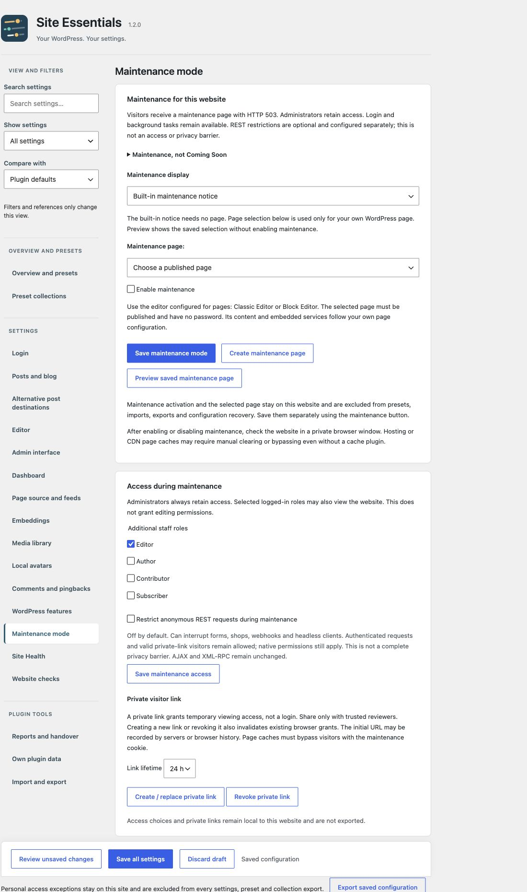

# Maintenance mode

[Deutsch](Wartungsmodus) · [Home](Home)

Explain a short interruption and selectively allow the people maintaining the website to view it.

## 1. Choose and preview the display

Under **Settings → Site Essentials → Maintenance mode**, choose the **built-in maintenance notice** or your **own WordPress page**. The built-in notice needs no page. A custom page must be published and have no password; use the Block Editor or Classic Editor to design it.

Use **Save maintenance mode** separately, then **Preview saved maintenance page**. Preview does not activate maintenance. After previewing, select **Enable maintenance** and save separately again.

Visitors receive HTTP **503 Service Unavailable** with `Retry-After`. Administrators retain access. A subtle orange Toolbar indicator highlights active maintenance. Active Bricks, Elementor and Breakdance maintenance modes take precedence.

## 2. Allow access deliberately

Administrators remain allowed. Select additional logged-in staff under **Additional staff roles** and **Save maintenance access** separately. This grants no additional editing permissions.

A **private visitor link** allows temporary viewing without signing in. It lasts 1, 24 or 72 hours; the browser grant lasts at most 24 hours and never beyond the link expiry. A new link is shown briefly only to the creating administrator. Replacing or revoking it invalidates existing browser grants too.

Share only over HTTPS with trusted reviewers. The URL can appear in server logs or browser history. Maintenance status, page assignment, roles and visitor links stay local and are excluded from presets and configuration transfers.

## 3. Restrict REST only when appropriate

**Restrict anonymous REST requests during maintenance** is separate and off by default. It can interrupt forms, shops, webhooks and headless clients. Authenticated requests and valid private-link visitors retain their native WordPress permissions. AJAX and XML-RPC remain unchanged.

## 4. Check visitors and caches

After enabling or disabling maintenance, use a private browser window. Test signed-out visitors, allowed roles and any visitor link separately. Hosting or CDN page caches may require clearing or bypassing even without a cache plugin. Caches must respect the maintenance cookie for allowed visitors.

## Deliberate boundaries

Maintenance is not complete access protection or a Coming Soon mode. HTTP 503 is intended for a temporary interruption. A long-term announcement page has different availability and search-engine requirements. [Why we keep these workflows separate](Deliberate-choices).

[Site Health](Site-Health) · [Website checks](Website-checks) · [FAQ](FAQ)
