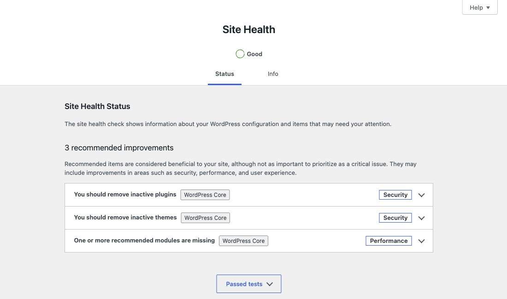
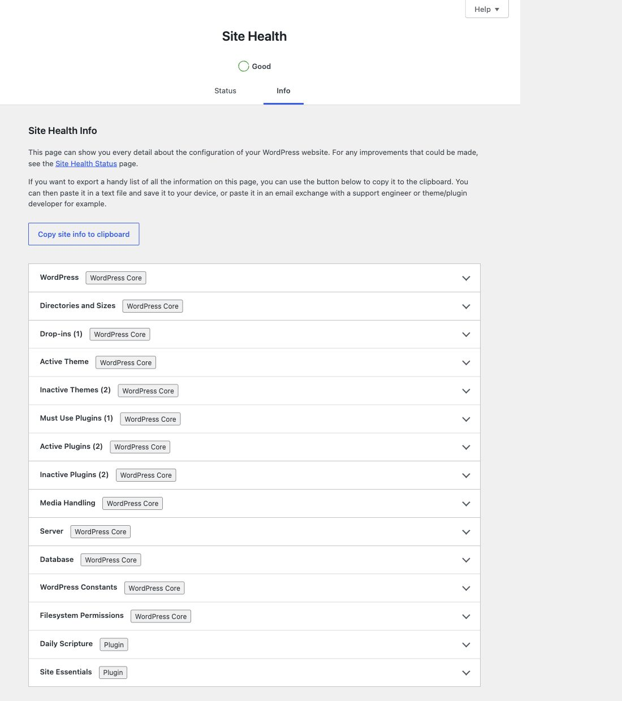
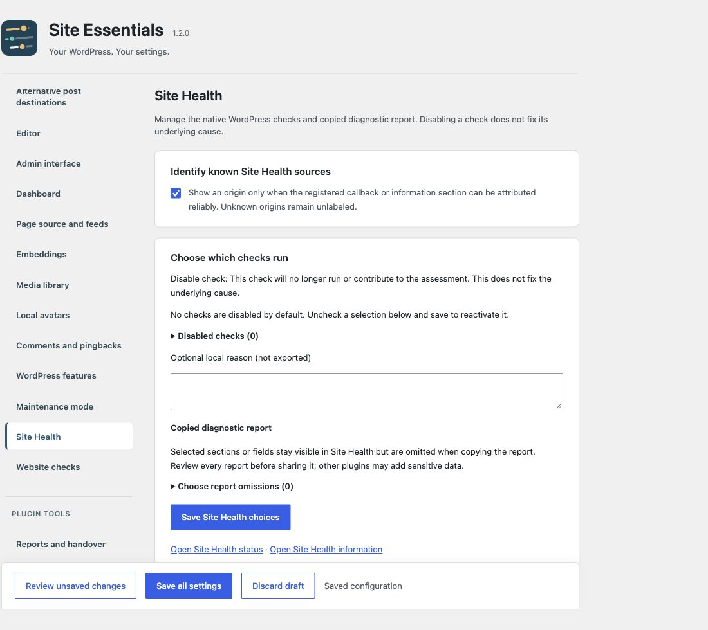

# Making Site Health useful

[Deutsch](Website-Zustand) · [Home](Home)

Identify sources, choose checks deliberately and limit copied diagnostic reports before sharing them.

## 1. Enable source labels

Under **Settings → Site Essentials → Site Health**, enable source labels and **Save all settings**. Open **Tools → Site Health**. Both **Status** and **Info** receive subtle labels.

“WordPress Core” identifies who supplies the check or information. A native section about plugins still comes from WordPress. Unambiguous additional plugin sections receive “Plugin”. Unknown sources remain unlabeled. Mixed sections label only reliably attributable fields. A source label is not a security or quality rating.

Attribution uses registered checks and local WordPress metadata. A plugin title alone is insufficient: the title, technical section ID and a uniquely identified active plugin must agree. No external attribution service is queried.

## 2. Manage individual checks

Expand the list under **Choose which checks run**, select a check and **Save Site Health choices**. An optional reason stays local. No check is disabled initially.

**Disable check:** This check will no longer run or contribute to the assessment. This does not fix the underlying cause.

To reactivate it, clear the selection and save separately. Then let the native checks run to completion again.

## 3. Share a report deliberately

Under **Copied diagnostic report**, exclude selected sections or fields from copying. All information remains visible in the admin. The copied report discloses omissions.

This is not complete anonymization. Review the copied text before sharing it; other plugins may add information.

## Where does each setting belong?

| Task | Settings section |
| --- | --- |
| Sources, selected checks, copied report | Site Health |
| Dashboard overview and personal extra rows | Dashboard and widget configuration |
| Privacy/imprint assignments, public URLs, manual homepage check | Website checks |
| Pending translation update preview | Admin interface |

Each setting appears in one place; other views provide shortcuts.

Continue: [Dashboard widget](Dashboard) · [Website checks](Website-checks) · [Translation updates](Translation-updates).
