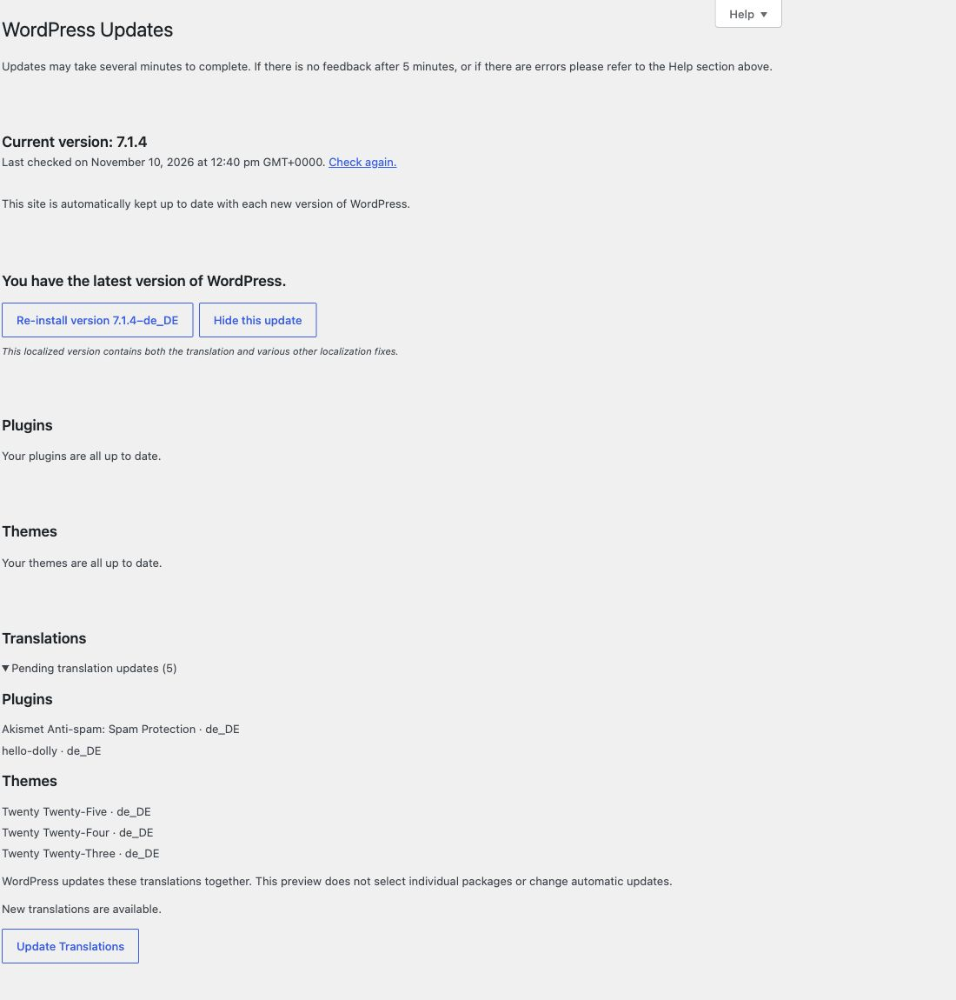

# Preview pending translation updates

[Deutsch](Uebersetzungsupdates) · [Home](Home)

See which components and languages have translation updates before starting the update.

## Show the preview

1. Under **Settings → Site Essentials → Admin interface**, enable **Show pending translation updates** and save.
2. Open **Dashboard → Updates** using an account authorized to perform updates.
3. When WordPress reports translation updates, expand **Pending translation updates** in **Translations**.

The list shows component type, name and language code, such as `de_DE`. The code identifies the package language, which can differ from your current admin language.

## Why is the list sometimes absent?

There is no additional list when no translation updates are pending. Automatic updates may already have installed language packs. The preview uses existing WordPress update data and does not start a separate update request. Use the normal WordPress **Check again** link when needed.

The screenshot shows five actual pending packages on a neutral test website. Your list depends on installed components and languages.

## What does the update button do?

The native **Update Translations** button updates the packages selected by WordPress together. Site Essentials offers no individual selection and does not change automatic updates.

[Site Health](Site-Health) · [Dashboard overview](Dashboard)
