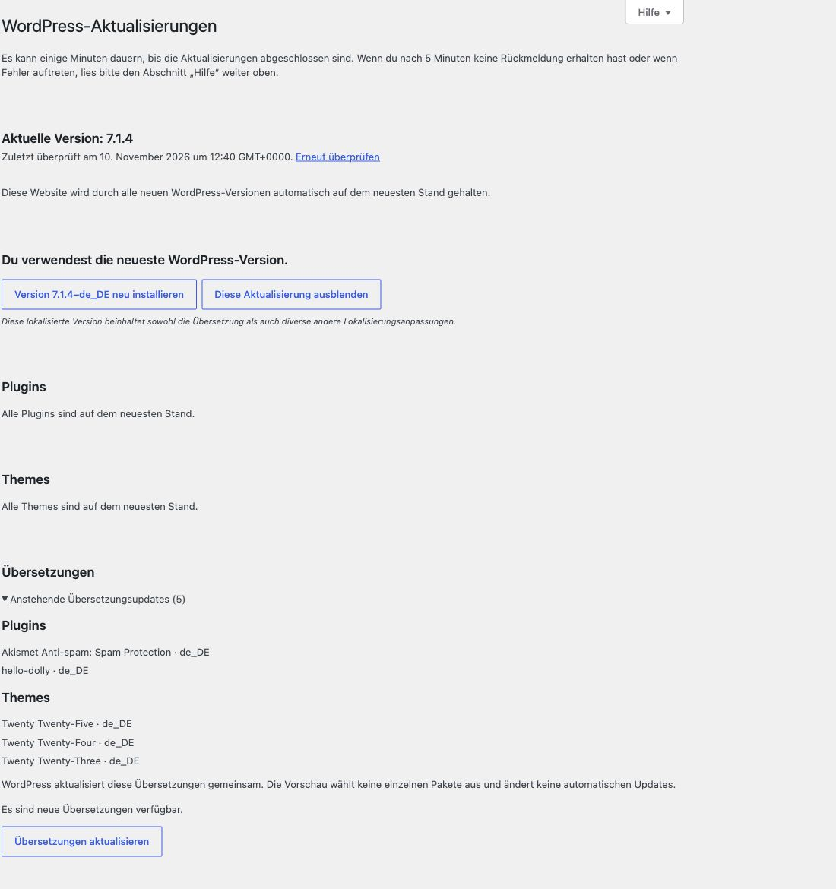

# Anstehende Übersetzungsupdates ansehen

[English](Translation-updates) · [Startseite](Home-de)

Vor dem Aktualisieren sehen, für welche Komponenten und Sprachen neue Übersetzungen bereitstehen.

## So erscheint die Vorschau

1. Unter **Einstellungen → Site Essentials → Admin-Oberfläche** die Option **Anstehende Übersetzungsupdates anzeigen** aktivieren und speichern.
2. **Dashboard → Aktualisierungen** mit einer für Updates berechtigten Person öffnen.
3. Wenn WordPress Übersetzungsupdates meldet, bei **Übersetzungen** die Liste **Anstehende Übersetzungsupdates** aufklappen.

Die Liste nennt Komponententyp, Name und Sprachkennung, beispielsweise `de_DE`. Diese Kennung bezeichnet die Zielsprache des Pakets und kann von deiner aktuellen Admin-Sprache abweichen.

## Warum ist manchmal nichts zu sehen?

Ohne anstehende Übersetzungsupdates erscheint keine zusätzliche Liste. Automatische Updates können Sprachpakete bereits installiert haben. Die Vorschau verwendet den vorhandenen WordPress-Updatestand; sie startet keinen eigenen Updateabruf. Bei Bedarf den normalen WordPress-Link **Erneut überprüfen** verwenden.

Die Aufnahme zeigt fünf tatsächlich anstehende Pakete einer neutralen Testwebsite. Welche Pakete bei dir erscheinen, hängt von installierten Komponenten und Sprachen ab.

## Was bewirkt der Update-Button?

Der native Button **Übersetzungen aktualisieren** aktualisiert die von WordPress vorgesehenen Pakete gemeinsam. Site Essentials bietet keine Einzelauswahl und ändert keine automatischen Updates.

[Website-Zustand](Website-Zustand) · [Dashboard-Überblick](Dashboard-de)
