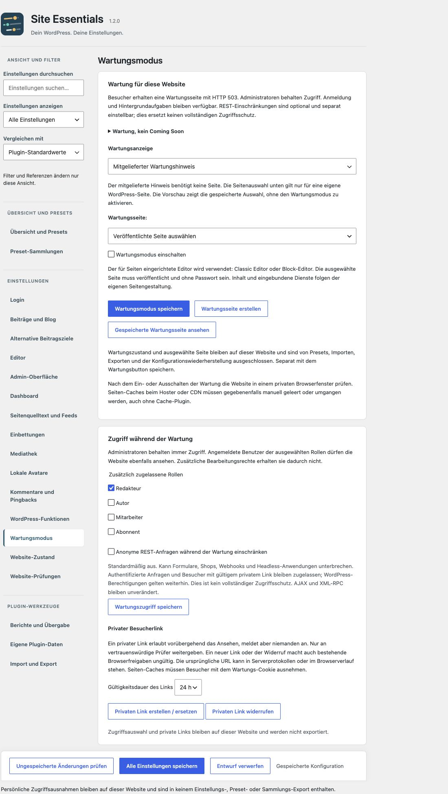

# Wartungsmodus

[English](Maintenance) · [Startseite](Home-de)

Eine kurze Unterbrechung verständlich anzeigen und den Zugriff für die Betreuung gezielt freigeben.

## 1. Anzeige wählen und vorab ansehen

Unter **Einstellungen → Site Essentials → Wartungsmodus** den **mitgelieferten Wartungshinweis** oder eine **eigene WordPress-Seite** wählen. Für den mitgelieferten Hinweis ist keine Seite erforderlich. Eine eigene Seite muss veröffentlicht und ohne Passwort sein; sie kann mit Block Editor oder Classic Editor gestaltet werden.

Mit **Wartungsmodus speichern** separat speichern und anschließend **Gespeicherte Wartungsseite ansehen** verwenden. Die Vorschau aktiviert den Modus nicht. Erst nach der Vorschau **Wartungsmodus einschalten** auswählen und erneut separat speichern.

Besucher erhalten HTTP **503 Service Unavailable** mit `Retry-After`. Administratoren behalten Zugriff. Ein dezenter orangefarbener Toolbar-Hinweis erinnert an die aktive Wartung. Aktive Wartungsmodi von Bricks, Elementor und Breakdance haben Vorrang.

## 2. Zugriff bewusst erlauben

Administratoren bleiben zugelassen. Unter **Zusätzlich zugelassene Rollen** können angemeldete Benutzer weiterer Rollen zugelassen werden. **Wartungszugriff speichern** übernimmt diese Auswahl separat. Sie erteilt keine zusätzlichen Bearbeitungsrechte.

Ein **privater Besucherlink** erlaubt zeitweiliges Ansehen ohne Anmeldung. Seine Gültigkeit beträgt 1, 24 oder 72 Stunden; die Browserfreigabe höchstens 24 Stunden und nie länger als der Link. Der neue Link wird kurz nur dem erstellenden Administrator angezeigt. Ersetzen oder Widerrufen entzieht auch bestehenden Browserfreigaben den Zugriff.

Den Link nur über HTTPS an vertrauenswürdige Prüfer geben. Er kann in Serverprotokollen oder im Browserverlauf stehen. Wartungszustand, Seitenzuordnung, Rollen und Besucherlinks bleiben lokal und werden nicht mit Presets oder Konfigurationen übertragen.

## 3. REST nur bei passendem Anwendungsfall einschränken

**Anonyme REST-Anfragen während der Wartung einschränken** ist eine separate Option und standardmäßig aus. Sie kann Formulare, Shops, Webhooks und Headless-Anwendungen unterbrechen. Authentifizierte Anfragen und Besucher mit gültigem Privatlink bleiben unter ihren nativen WordPress-Berechtigungen zugelassen. AJAX und XML-RPC bleiben unverändert.

## 4. Besucheransicht und Cache prüfen

Nach dem Ein- und Ausschalten ein privates Browserfenster verwenden. Abgemeldete Besucher, zugelassene Rollen und einen gegebenenfalls erzeugten Besucherlink getrennt testen. Seiten-Caches beim Hoster oder CDN müssen gegebenenfalls geleert oder umgangen werden – auch ohne Cache-Plugin. Für freigegebene Besucher muss der Cache das Wartungs-Cookie berücksichtigen.

## Bewusste Grenzen

Wartung ist kein vollständiger Zugriffsschutz und kein Coming-Soon-Modus. HTTP 503 ist für eine vorübergehende Unterbrechung vorgesehen. Eine längerfristige Ankündigungsseite hat andere Anforderungen an Erreichbarkeit und Suchmaschinen. [Warum wir das bewusst trennen](Bewusste-Entscheidungen).

[Website-Zustand](Website-Zustand) · [Website-Prüfungen](Website-Pruefungen) · [FAQ](FAQ-de)
