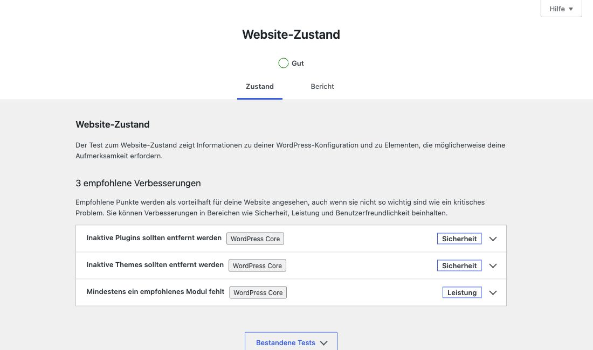
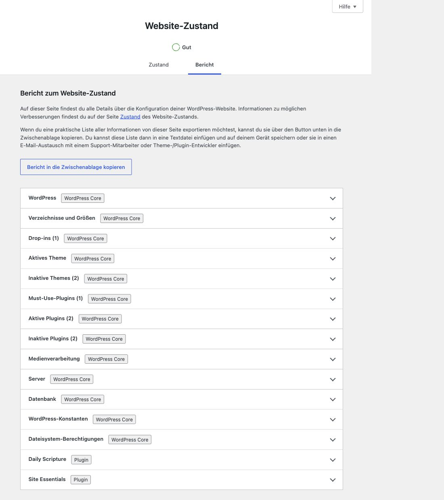
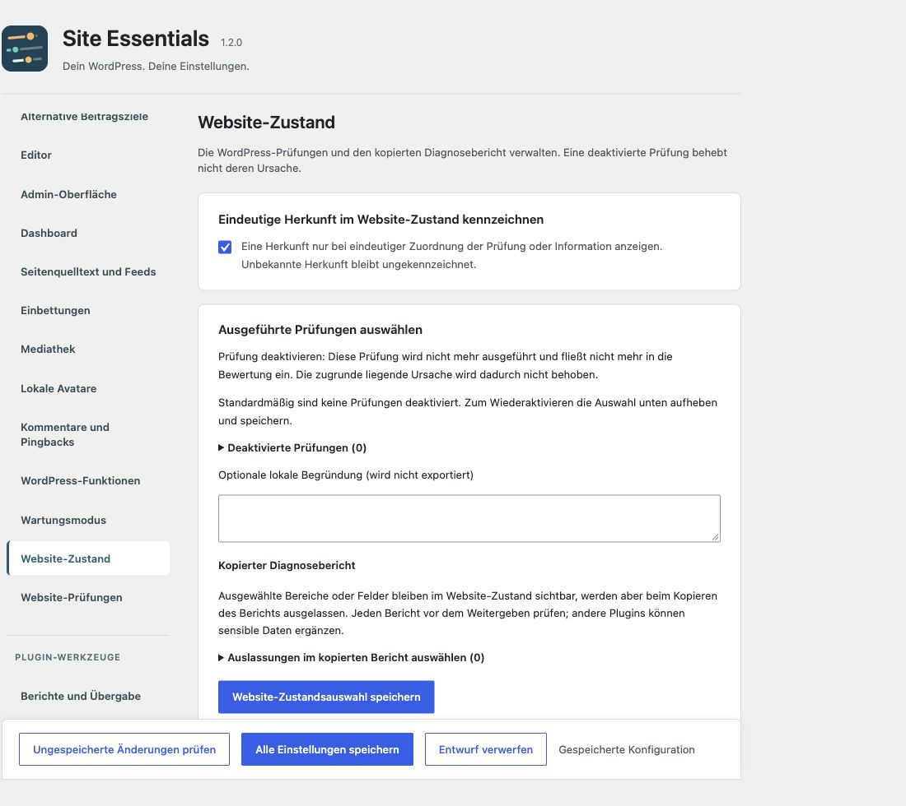

# Website-Zustand verständlich nutzen

[English](Site-Health) · [Startseite](Home-de)

Herkunft erkennen, Prüfungen bewusst auswählen und Diagnoseberichte vor dem Teilen begrenzen.

## 1. Herkunft einschalten

Unter **Einstellungen → Site Essentials → Website-Zustand** die Herkunftskennzeichnung aktivieren und **Alle Einstellungen speichern**. Danach **Werkzeuge → Website-Zustand** öffnen. Die Ansichten **Zustand** und **Bericht** erhalten dezente Kennzeichnungen.

„WordPress Core“ bezeichnet die Herkunft der Prüfung oder Information. Ein Core-Bereich über Plugins stammt deshalb weiterhin von WordPress. Eindeutige zusätzliche Plugin-Bereiche erhalten „Plugin“. Unbekannte Quellen bleiben ungekennzeichnet. Bei gemischten Berichten werden nur eindeutig zuordenbare Felder markiert. Die Kennzeichnung ist keine Sicherheits- oder Qualitätsbewertung.

Der Abgleich nutzt registrierte Prüfungen und lokale WordPress-Metadaten. Ein Plugin-Titel allein genügt nicht: Titel, technischer Abschnittsname und ein eindeutig zuordenbares aktives Plugin müssen zusammenpassen. Es werden keine externen Zuordnungsdienste aufgerufen.

## 2. Prüfungen gezielt verwalten

Unter **Ausgeführte Prüfungen auswählen** die Liste aufklappen, eine Prüfung auswählen und **Website-Zustandsauswahl speichern**. Eine optionale Begründung bleibt lokal. Anfangs ist keine Prüfung deaktiviert.

**Prüfung deaktivieren:** Diese Prüfung wird nicht mehr ausgeführt und fließt nicht mehr in die Bewertung ein. Die zugrunde liegende Ursache wird dadurch nicht behoben.

Zum Wiederaktivieren die Auswahl aufheben und separat speichern. Anschließend die nativen Prüfungen erneut vollständig durchlaufen lassen.

## 3. Einen Bericht bewusst weitergeben

Unter **Kopierter Diagnosebericht** lassen sich Bereiche oder einzelne Felder vom Kopieren ausnehmen. Die Informationen bleiben im Admin sichtbar. Der kopierte Bericht weist auf Auslassungen hin.

Dies ist keine vollständige Anonymisierung. Den kopierten Text vor dem Weitergeben prüfen; andere Plugins können zusätzliche Daten liefern.

## Welche Rubrik ist zuständig?

| Aufgabe | Einstellungsort |
| --- | --- |
| Herkunft, Prüfauswahl, kopierter Bericht | Website-Zustand |
| Website-Zustand auf dem Dashboard, persönliche Zusatzzeilen | Dashboard bzw. Widget-Konfiguration |
| Datenschutz-/Impressumszuordnung, öffentliche URLs, manuelle Startseitenprüfung | Website-Prüfungen |
| Vorschau anstehender Übersetzungsupdates | Admin-Oberfläche |

Jede Einstellung steht an einer Stelle; andere Ansichten bieten Sprunglinks.

Weiter: [Dashboard-Widget](Dashboard-de) · [Website-Prüfungen](Website-Pruefungen) · [Übersetzungsupdates](Uebersetzungsupdates).
